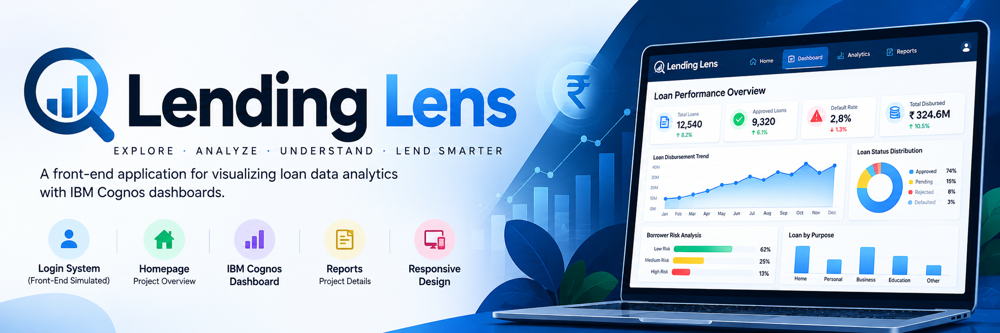
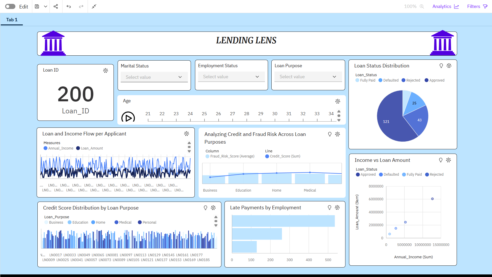
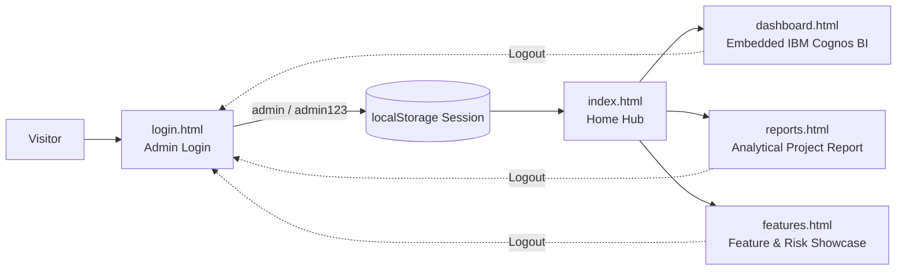

<div align="center">

  

  # 🔍 Lending Lens
  ### *Frontend Web Application for Loan Analysis & Cognos BI Dashboards*

  <p align="center">
    <b>Lending Lens is a frontend-based web application for loan analysis and prediction that helps assess borrower behavior, predict loan approvals, and visualize financial risks. It includes admin login, interactive dashboards (Cognos), and reports.</b>
  </p>

  <p align="center">
    
    
    
    
    
    
  </p>

</div>

---

## 📑 Table of Contents

- [📌 Overview](#-overview)
- [✨ Key Features](#-key-features)
- [🖥️ System Previews](#️-system-previews)
- [🧭 Application Architecture & Workflow](#-application-architecture--workflow)
- [🛠️ Tech Stack](#️-tech-stack)
- [🔐 Demo Authentication](#-demo-authentication)
- [🚀 Quick Start & Installation](#-quick-start--installation)
- [📂 Project Structure](#-project-structure)
- [📊 Business Intelligence Highlights](#-business-intelligence-highlights)
- [🤝 Contributing](#-contributing)
- [📄 License](#-license)

---

## 📌 Overview

**Lending Lens** is a lightweight frontend web application developed to showcase loan portfolio analytics and risk evaluation. The core of the project connects an interactive **IBM Cognos Analytics** dashboard directly into an HTML/CSS/JavaScript web interface, providing an accessible portal for reviewing credit trends, approval patterns, and borrower financial indicators.

Instead of complex backend infrastructures, the project demonstrates how business intelligence dashboards can be embedded cleanly into modern client-side web interfaces with client-side authentication, structured analytical summaries, and loan product configuration mockups.

### Highlights
- 📊 **Direct Cognos Embed**: Visual dashboard created in IBM Cognos Analytics and integrated straight into HTML via a responsive iframe.
- 🎯 **Credit & Risk Analysis**: Visual exploration of loan applicant data across credit score tiers, debt-to-income (DTI) ratios, and approval rates.
- ⚡ **100% Client-Side**: Runs directly in any web browser without server setup, backend runtime, or database dependencies.
- 📑 **Comprehensive Portal**: Bundles a home hub, demo login flow, live embedded dashboard, editable analytical report, and feature management showcase.

---

## ✨ Key Features

<table>
  <tr>
    <td width="50%">
      <h3>📈 Embedded Cognos BI Dashboard</h3>
      <ul>
        <li>Interactive dashboard built in <b>IBM Cognos Analytics</b>.</li>
        <li>Embedded directly into <code>dashboard.html</code> via a responsive iframe.</li>
        <li>Visualizes loan amounts, approval vs. rejection distributions, credit scores, and applicant metrics.</li>
      </ul>
    </td>
    <td width="50%">
      <h3>🔐 Simulated Authentication</h3>
      <ul>
        <li>Client-side credential verification with session state stored in <code>localStorage</code>.</li>
        <li>Route protection guarding access to Dashboard, Reports, and Features.</li>
        <li>Single-click logout mechanism that resets session access.</li>
      </ul>
    </td>
  </tr>
  <tr>
    <td width="50%">
      <h3>📋 Analytical Project Reports</h3>
      <ul>
        <li>Accordion-style analytical documentation covering project methodology and approval trends.</li>
        <li><b>Live Editable Mode</b>: Toggle inline <code>contenteditable</code> to customize report notes on the fly.</li>
        <li>Clear summaries of applicant insights and lending metrics.</li>
      </ul>
    </td>
    <td width="50%">
      <h3>⚙️ Feature & Risk Showcase</h3>
      <ul>
        <li><b>Loan Product Management</b>: Configurable parameters for Personal, Business, and Home loans.</li>
        <li><b>Custom Risk Settings</b>: Visualized criteria for credit score cutoffs and DTI thresholds.</li>
        <li><b>Feature Toggles</b>: Demonstrates modular feature enablement without code modifications.</li>
      </ul>
    </td>
  </tr>
</table>

---

## 🖥️ System Previews

<div align="center">
  <h3>📊 IBM Cognos Embedded Analytics View</h3>
  
</div>

---

## 🧭 Application Architecture & Workflow



---

## 🛠️ Tech Stack

| Layer | Technology | Role in Project |
| :--- | :--- | :--- |
| **Frontend UI** | `HTML5`, `CSS3` | Page structure, layout, custom styling, and responsive UI |
| **Styling Framework** | `Bootstrap 5.3` | Responsive grid system, accordions, and navigation components |
| **Client-Side Logic** | `JavaScript (ES6+)` | Session handling (`localStorage`), navigation updates, and inline editing |
| **Business Intelligence** | `IBM Cognos Analytics` | Cloud-hosted BI dashboard connected directly into the HTML web application |
| **Dataset** | `Microsoft Excel (.xlsx)` | Loan applicant data ([`data/lending lens .xlsx`](data/lending%20lens%20.xlsx)) used for building the Cognos visualizations |

---

## 🔐 Demo Authentication

To log in and access the full suite of pages, use the following preconfigured test credentials:

| Field | Credentials |
| :--- | :--- |
| **Username** | `admin` |
| **Password** | `admin123` |
| **Access Scope** | Dashboard, Reports, Features, and Navigation Controls |

> ℹ️ *Note: Authentication is simulated on the client side using `localStorage`.*

---

## 🚀 Quick Start & Installation

Because **Lending Lens** is purely client-side, running it locally requires no build step, Node.js packages, or web server setup:

### Option 1: Direct File Launch
1. **Clone the repository:**
   ```bash
   git clone https://github.com/Aakash02A/BI-Lending-Lens.git
   ```
2. **Navigate into the project directory:**
   ```bash
   cd BI-Lending-Lens
   ```
3. **Launch the application:**
   - Open [`index.html`](index.html) or [`login.html`](login.html) directly in any modern browser (Chrome, Edge, Firefox, Safari).

---

### Option 2: Run with VS Code Live Server
1. Open the project folder in **Visual Studio Code**.
2. Install the **Live Server** extension (`ritwickdey.liveserver`).
3. Right-click on [`index.html`](index.html) and select **"Open with Live Server"**.
4. The application will launch at `http://127.0.0.1:5500/index.html`.

---

## 📂 Project Structure

```text
BI-Lending-Lens/
│
├── assets/
│   ├── Banner.png                  # Project banner graphic
│   └── Dashboard.png               # Cognos dashboard preview screenshot
│
├── data/
│   └── lending lens .xlsx          # Underlying loan applicant dataset
│
├── index.html                      # Main home landing page & navigation hub
├── login.html                      # Authentication gateway with credential check
├── dashboard.html                  # Embedded IBM Cognos analytics dashboard (via iframe)
├── reports.html                    # Analytical project report with live editable accordions
├── features.html                   # Loan management, risk rules & feature showcase
│
├── LICENSE                         # MIT License
└── README.md                       # Repository documentation
```

---

## 📊 Business Intelligence Highlights

The underlying dataset ([`data/lending lens .xlsx`](data/lending%20lens%20.xlsx)) profiles loan applicants across core credit indicators, which are visualized through IBM Cognos:

- **Credit Score Distribution**: Visualizing applicant credit brackets and their relationship to loan outcomes.
- **Debt-to-Income (DTI) Analysis**: Reviewing applicant debt obligations against income to assess risk exposure.
- **Approval & Rejection Trends**: Comparative breakdown of approved vs. rejected loan applications.
- **Direct Web Integration**: Clean iframe embedding of the Cognos dashboard directly into the web application layout.

---

## 🤝 Contributing

Contributions, feedback, and suggestions are welcome!

1. Fork the Project (`https://github.com/Aakash02A/BI-Lending-Lens/fork`)
2. Create your Feature Branch (`git checkout -b feature/AmazingFeature`)
3. Commit your Changes (`git commit -m 'Add some AmazingFeature'`)
4. Push to the Branch (`git push origin feature/AmazingFeature`)
5. Open a Pull Request

---

## 📄 License

This project is licensed under the **MIT License** - see the [LICENSE](LICENSE) file for details.

---

<div align="center">
  <sub>Built for data-driven financial analytics and clean web engineering.</sub>
</div>
